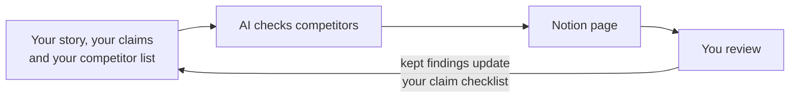
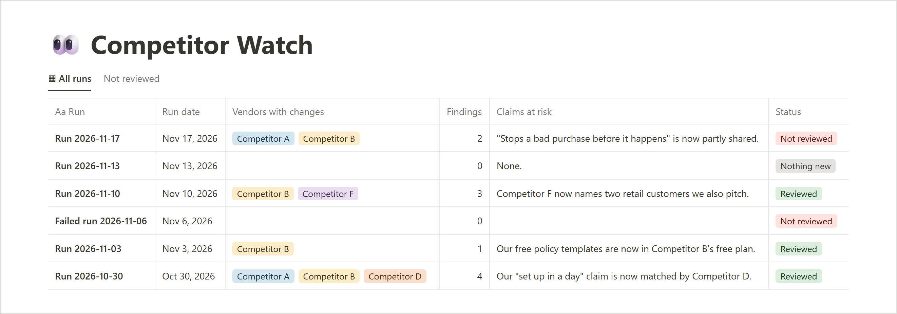
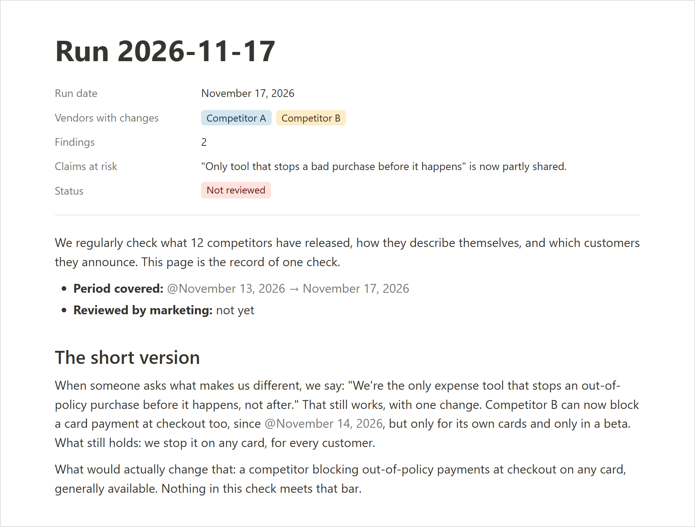
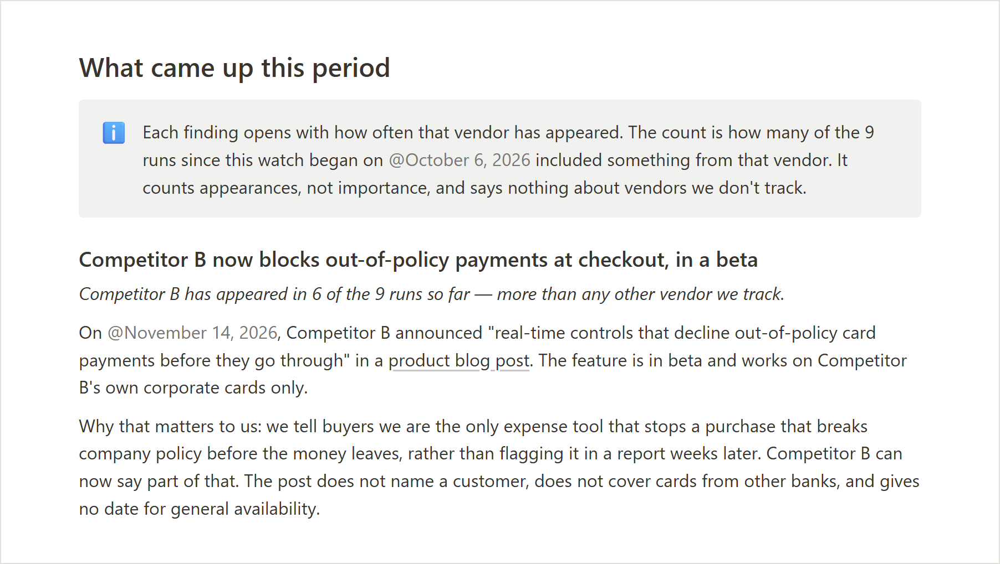

  

<h2 align="center">👀 Catch every move your competitors make, and see whether your pitch still holds up.</h2>

Have you ever:
- told a prospect "we're the only ones who do X," then heard on the call that a competitor launched it last month?
- looked at the differentiators on your website and wondered if they're still true?
- learned about a competitor's launch from a customer, before your own team knew?

That's what this is for: keeping your positioning and differentiation true as competitors move. It is not a social listening tool. It doesn't track posts, mentions or sentiment. It reads what competitors publish about their product and tells you which of your claims (the reasons you give buyers to pick you) it affects. Each check becomes one Notion page. You review it; nothing changes without you.

Runs on [Claude Code](https://code.claude.com). Every step is a plain text file you can read and edit.

## Start here

| You want to | Go to |
|---|---|
| **See what a check looks like** | [What you get](#-what-you-get): an example page. |
| **Set it up** | [Setup](#-setup): three steps in GitHub, Notion and Claude. |
| **Review a check** | [Reviewing a check](#-reviewing-a-check): keep, fix or drop each finding. |
| **Know if it's for you** | [Questions people ask](#-questions-people-ask) |

## ⚙️ How it works

| Step | What happens |
|---|---|
| **Read** | Your three files: your story (`positioning.md`), your claims (`claims.md`) and your competitor list (`competitors.md`). |
| **Skip** | Anything earlier checks already reported. |
| **Look** | Each competitor's own website, docs and announcements. Never articles about them. |
| **Judge** | Keeps only findings that touch one of your claims: still yours, now shared with a competitor, or no longer usable. |
| **Verify** | Reopens every link, confirms every quote and date, deletes what it can't confirm. |
| **Write** | One short Notion page anyone in the company can read. |

**Read-only. Every link rechecked. Nothing changes without your review.**

## 👀 What you get

A Notion database that fills up with one page per check. This example uses a made-up expense tool and made-up competitors:

*Every check in one table: what changed, which claim is at risk, what's still waiting for review*

Open a check and you get one page:

| | |
|---|---|
|  |  |
| *The short version: does your main claim still hold?* | *One finding: what happened, why it matters, what it doesn't prove* |

## 📁 Your three files

All in `context/`:

| File | What it is | Changes |
|---|---|---|
| `positioning.md` | Your story: what you sell, to whom, what they use instead, why you win. | Rarely |
| `claims.md` | Your claim checklist: each claim, whether it still holds, since when, and the proof. E.g. *"Set up in a day": no longer only ours, Competitor D matched it on Oct 30 (link).* | After each review |
| `competitors.md` | Who to check and where they post news. | When the list changes |

Two files for claims on purpose: positioning is what you say, the checklist is whether it's still true. A competitor's launch updates the checklist, never your story.

> 💡 **Tip:** see [`examples/`](examples/) for all three filled in for a made-up company. Then fill in `positioning.md` and ask Claude to draft `claims.md` from it and your website.

## 🚀 Setup

| Where | What to do |
|---|---|
| **1. GitHub** | **Fork** this project (private is fine), fill in the three files in `context/` and save them. |
| **2. Notion** | Open the [Competitor Watch template](https://worried-can-14d.notion.site/41de2a563ab78161aea5e5cf815e4a3e?v=41de2a563ab7810385b5000cf34a53bc), click **Duplicate**, then delete the example row. |
| **3. Claude** | Connect Notion at [claude.ai/customize/connectors](https://claude.ai/customize/connectors), add the database ID to the instructions, then schedule the check. |

<b>Prefer to build the database yourself?</b>

 

Create a database called **Competitor Watch** with these columns. Names must match exactly.

| Column | Type |
|---|---|
| Run | Title |
| Run date | Date |
| Vendors with changes | Multi-select |
| Findings | Number |
| Claims at risk | Text |
| Status | Select: `Not reviewed`, `Reviewed`, `Nothing new` |

<b>Adding the database ID</b>

 

Ask Claude: *"give me the data source ID of my Competitor Watch database"*. Paste it into both files in `prompts/` where it says `<NOTION_DATA_SOURCE_ID>`, and save them to GitHub.

<b>Scheduling the check</b>

 

At [claude.ai/code/routines](https://claude.ai/code/routines) > **New task**. Needs a paid Claude plan; it asks to connect GitHub the first time.

| Field | Enter |
|---|---|
| Prompt | `Read prompts/competitor-watch.md in this repo and follow it exactly.` |
| Schedule | Custom: `0 4 * * 2,5` (Tue and Fri, 4:00 UTC) |
| Repository | Your copy |
| Model | The most capable one |
| Connectors | Keep Notion (and Slack for alerts), remove the rest |

Click **Create**, then **Run now**.

> ⚠️ The first check looks back 90 days. Click through a few findings to their sources before trusting the rest.

## 🔔 Getting alerted

Want a Slack message when a check finds something? Connect Slack to Claude, then edit the last line of `prompts/competitor-watch.md` to e.g. `Notify: Slack, channel #competitor-watch`. Otherwise, turn on Notion notifications for the database.

## ✅ Reviewing a check

In Claude Code on your computer, open your copy of this project and type *"follow prompts/review.md"*. Claude:

1. Shows the findings three or four at a time, each marked **keep**, **fix** or **drop**.
2. Takes your answer for the group ("keep all", "drop 4").
3. Updates `claims.md`, marks the page reviewed and offers to save the change to GitHub.

**Or by hand:** read the page, edit `claims.md` on GitHub, set the page to `Reviewed`.

## ❓ Questions people ask

<b>What does it cost?</b>

No subscription of its own. Scheduled checks need a paid Claude plan, and each check uses part of that plan's usage. The pages go to your existing Notion workspace.

<b>Is this social listening?</b>

No. It doesn't track posts, mentions or sentiment. It reads competitors' own websites, docs and announcements, and only reports what touches the claims you make.

<b>Does it work for my market?</b>

If your competitors publish news, docs or customer stories online, yes. It knows nothing about your market until you fill in the three files, and it's only as sharp as your claim checklist.

<b>Can I use something other than Notion?</b>

Yes. Notion is what it's set up for, but the instructions are plain text. Connect the tool you use to Claude (e.g. Google Docs), then ask Claude to rewrite the "write the page" step in `prompts/competitor-watch.md` and the matching steps in `prompts/review.md` for it.

<b>Will it change my files or my website?</b>

No. A check only reads the web and writes one page. Your claim checklist changes only when you review, and only with your yes.

<b>Can it make things up?</b>

AI can. That's why every check reopens each link, confirms each quote and date, and deletes what it can't confirm. Still, click through the first few findings before you trust it.

<b>What can't it see?</b>

Anything competitors don't publish: roadmaps, sales conversations, gated content, and often pricing. Some sites block automated visits; those competitors show up as "not covered" and are tried again next time.

<b>How many competitors, how often?</b>

The original setup checks 25 competitors twice a week. Add or remove competitors in `competitors.md` and change the schedule in the task's settings. Each check only reports what's new since the last one, so more often means shorter pages, not more noise.

<b>Can my team read the pages?</b>

Yes, that's who they're written for: plain words, no internal shorthand. Share the Notion database with sales, product or anyone who gets asked about competitors.

## 🛠️ If something goes wrong

Open the run in the task's **History** to see what Claude did. Most failures are a Notion column name that doesn't match exactly, a wrong database ID, or Notion missing from the task's connectors.

---

## 👋 Built by Yannis Asimakopoulos

Honest writing on marketing, AI, and figuring it out as you go.

[LinkedIn](https://www.linkedin.com/in/yannis-asimakopoulos/) · [Substack](https://substack.com/@yannisasimako)

---

MIT license
