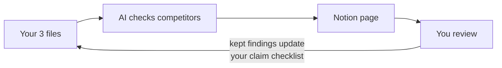

# 🔭 Competitor Watch

**Twice a week, an AI checks what your competitors launched and tells you whether your reasons to be picked still hold.**

It looks at what competitors released, how they describe themselves now, and which customers they announced, and checks each finding against your "claims": the reasons you give buyers to pick you, e.g. "the only tool that does X". Each check becomes one Notion page. You review it; nothing changes without you.

Runs on [Claude Code](https://code.claude.com), Anthropic's AI assistant. Every step is a plain text file you can read and edit.

---

## ⚙️ How it works

1. Reads your three files (below).
2. Skips anything earlier checks already reported.
3. Visits each competitor's own website, docs and announcements.
4. Keeps only findings that touch one of your claims, and says whether each claim is still yours, now shared with a competitor, or no longer usable.
5. Reopens every link and deletes anything it can't confirm.
6. Writes a short Notion page anyone in the company can read.

## 📁 Your three files

All in `context/`:

| File | What it is | Changes |
|---|---|---|
| `positioning.md` | Your story: what you sell, to whom, what they use instead, why you win. | Rarely |
| `doctrine.md` | Your claim checklist: each claim, whether it still holds, since when, and the proof. | After each review |
| `competitors.md` | Who to check and where they post news. | When the list changes |

Two files for claims on purpose: positioning is what you say, the checklist is whether it's still true. A competitor's launch updates the checklist, never your story.

> 💡 **Tip:** fill in `positioning.md`, then ask Claude to draft `doctrine.md` from it and your website.

---

## 🚀 Setup

**1. Copy this project**
Use the **Fork** button (private is fine), fill in the three files and save them to GitHub.

**2. Create a Notion database** called **Competitor Watch** with these columns:

| Column | Type |
|---|---|
| Run | Title |
| Run date | Date |
| Vendors with changes | Multi-select |
| Findings | Number |
| Claims at risk | Text |
| Status | Select: `Not reviewed`, `Reviewed`, `Nothing new` |

**3. Connect Notion to Claude**
At [claude.ai/customize/connectors](https://claude.ai/customize/connectors). Then ask Claude: *"give me the data source ID of my Competitor Watch database"*, and paste it into both files in `prompts/` where it says `<NOTION_DATA_SOURCE_ID>`.

**4. Schedule it**
At [claude.ai/code/routines](https://claude.ai/code/routines) > **New task**. Needs a paid Claude plan; it asks to connect GitHub the first time.

| Field | Enter |
|---|---|
| Prompt | `Read prompts/competitor-watch.md in this repo and follow it exactly.` |
| Schedule | Custom: `0 4 * * 2,5` (Tue and Fri, 4:00 UTC) |
| Repository | Your copy |
| Model | The most capable one |
| Connectors | Keep Notion (and Slack for alerts), remove the rest |

Click **Create**, then **Run now**.

> ⚠️ The first check looks back 90 days. Click through a few findings to their sources before trusting the rest.

---

## 🔔 Getting alerted

Want a Slack message when a check finds something? Connect Slack to Claude, then edit the last line of `prompts/competitor-watch.md` to e.g. `Notify: Slack, channel #competitor-watch`. Otherwise, turn on Notion notifications for the database.

## ✅ Reviewing a check

In Claude Code on your computer, open your copy of this project and type *"follow prompts/review.md"*. Claude:

1. Shows the findings three or four at a time, each marked **keep**, **fix** or **drop**.
2. Takes your answer for the group ("keep all", "drop 4").
3. Updates `doctrine.md`, marks the page reviewed and offers to save the change to GitHub.

**Or by hand:** read the page, edit `doctrine.md` on GitHub, set the page to `Reviewed`.

## 🛠️ If something goes wrong

Open the run in the task's **History** to see what Claude did. Most failures are a Notion column name that doesn't match exactly, a wrong database ID, or Notion missing from the task's connectors.

---

MIT license
